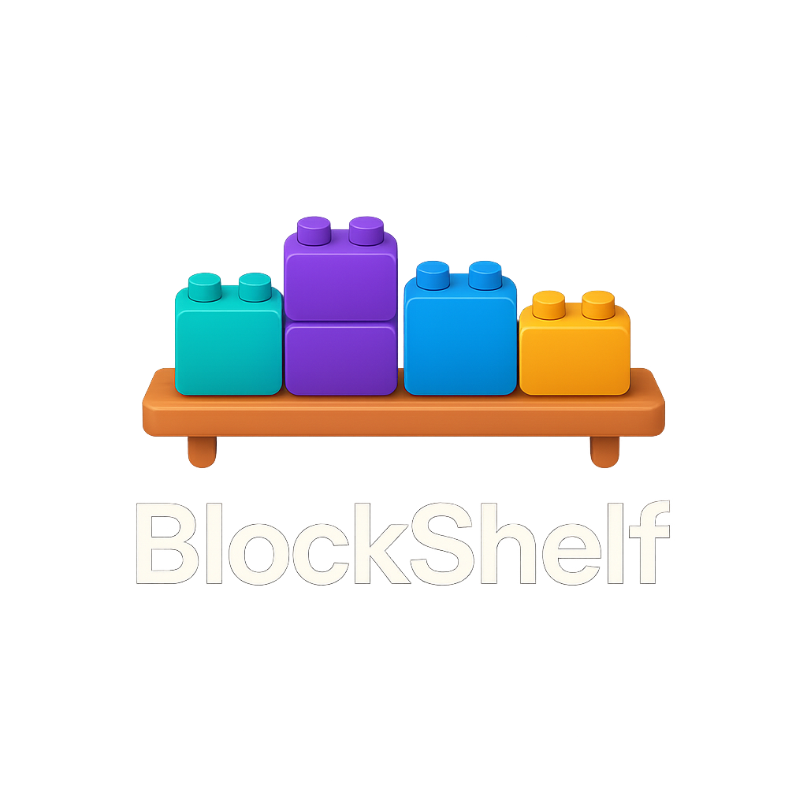
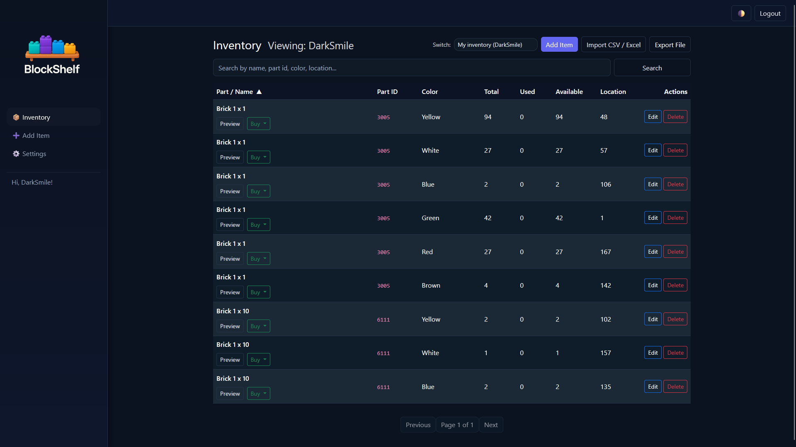
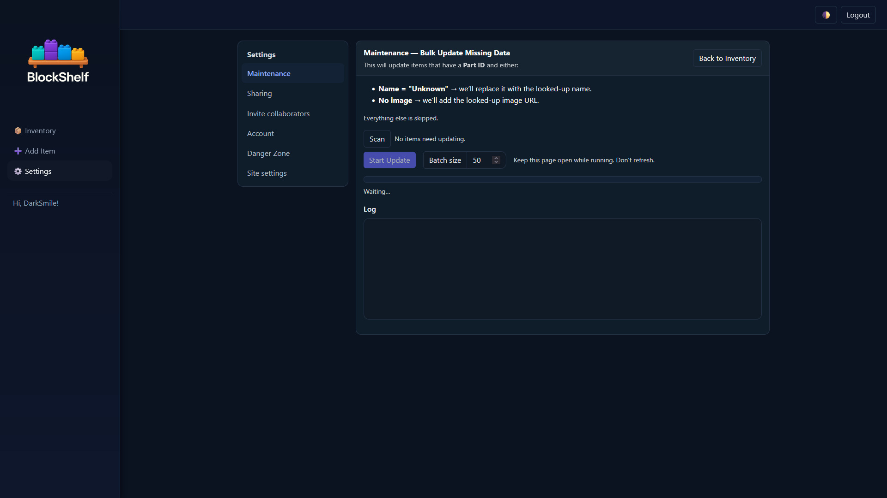
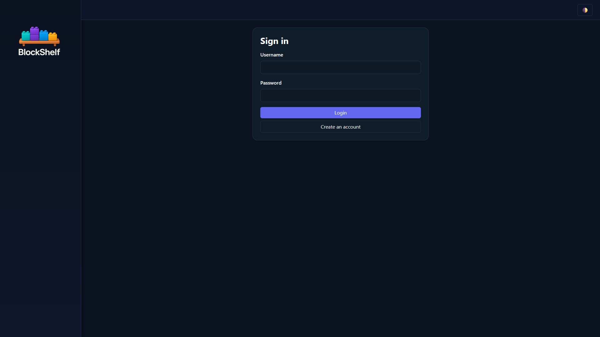
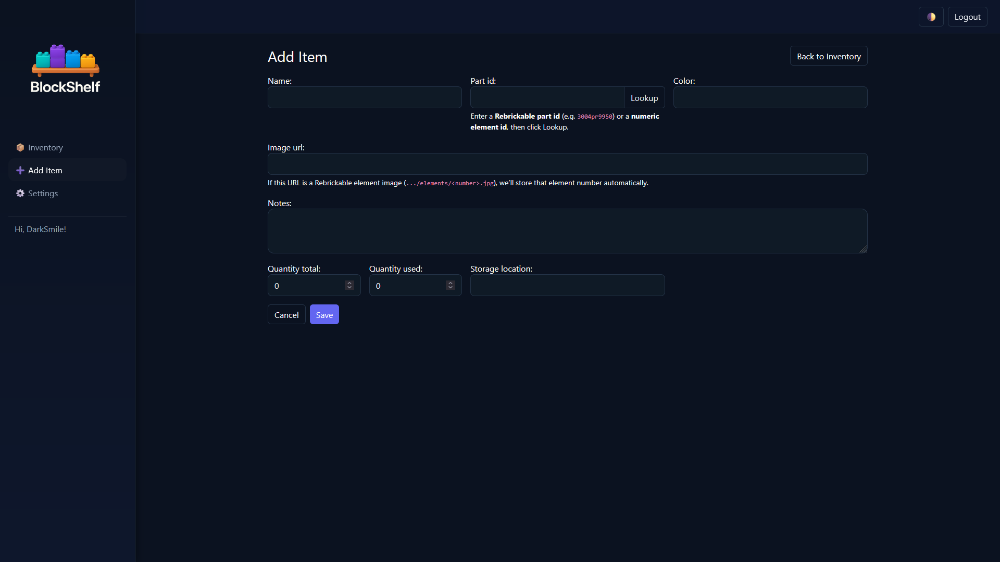
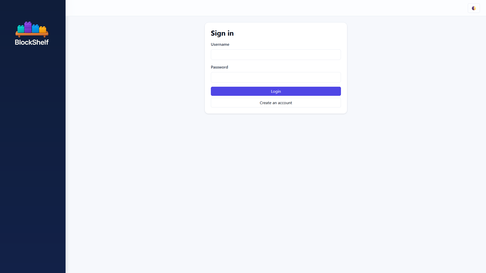
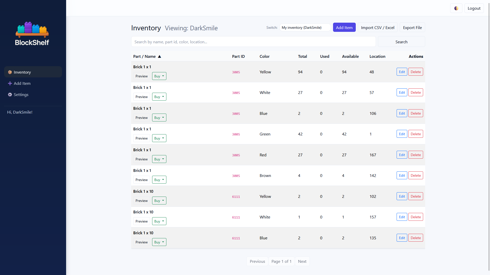

<p align="center">
  
</p>

<h1 align="center">BlockShelf</h1>

<p align="center">
  A clean, local‑first LEGO® parts inventory app — import, search, share, and collaborate.
</p>

<p align="center">
  <em>This project is Vibe Coded ✨</em>
</p>

---

## ✨ Features

### Core Functionality
- 📊 **Dashboard** - Overview with statistics, top items, low stock alerts, and quick actions
- 🔎 **Clean inventory UI** - Search, sort, pagination & dark mode
- 📥 **Import/Export** - CSV/XLS/XLSX import and CSV export
- 🧠 **Smart lookups** - Local-first part lookups with Rebrickable API fallback
- 🧩 **Rebrickable Bootstrap** - Seed local data from downloads ZIP (`colors.csv`, `parts.csv`, `elements.csv`)

### Collaboration & Sharing
- 🔗 **Share links** - Public read-only inventory links
- 👥 **Collaborator invitations** - Invite users with custom permissions (view/edit/delete)
- 🔄 **Inventory switching** - View and manage inventories you have access to

### Data Management
- 💾 **Automated backups** - Full database and per-user inventory backups (CSV format)
- ⚙️ **Backup rotation** - Keeps 10 most recent backups per user
- 📅 **Scheduled backups** - Daily automatic backups at 2 AM via systemd timer
- 📝 **Notes system** - Built-in notepad for project planning
- 🔍 **Backup search** - Filter admin backup list by username

> **Note:** LEGO® is a trademark of the LEGO Group, which does not sponsor, authorize or endorse this project.

---

## 🚀 Quick Start

### Production Deployment (Recommended)

Install on Ubuntu/Debian using the revision already verified on Linux staging:

```bash
git clone https://github.com/DarkSmileee/BlockShelf.git BlockShelf-release
cd BlockShelf-release
git checkout --detach TESTED_COMMIT_SHA
sudo bash scripts/install_blockshelf.sh TESTED_COMMIT_SHA
```

The installer creates a fresh database; use the updater for an existing installation.
Configure the active Nginx site and certificates separately. Its upstream must match
Gunicorn at `127.0.0.1:8000`; see [rollout instructions](docs/AUDIT_FIXES.md).

The installer walks you through hostname, time zone, email backend, Cloudflare Turnstile keys, and whether to seed an admin user—no manual `.env` edits required for common settings.

**What it does:**
- Detects existing installations and prompts for confirmation
- Installs system dependencies (Python, PostgreSQL, Nginx, etc.)
- Creates database and user with secure auto-generated passwords
- Sets up systemd service for automatic startup
- Configures daily automatic backups at 2 AM
- Runs migrations and collects static files

**After installation:**
1. Update allowed hosts: `sudo nano /etc/blockshelf/.env`
2. Create superuser:
   ```bash
   sudo -u blockshelf bash -c 'source /etc/blockshelf/.env && /opt/blockshelf/.venv/bin/python /opt/blockshelf/manage.py createsuperuser'
   ```
3. Configure Nginx/SSL for your domain

### Cloudflare Turnstile (Enabled by default)

Turnstile protection ships enabled. Just point DNS through Cloudflare and provide your keys:

1. Generate a site key + secret in the Cloudflare dashboard.
2. Add the following to `/etc/blockshelf/.env` (or `.env` for dev):
   ```
   TURNSTILE_SITE_KEY=cf_site_key
   TURNSTILE_SECRET_KEY=cf_secret_key
   ```
3. Restart the service: `sudo systemctl restart blockshelf`

When enabled, both the first-party login page (`/login/`) and the allauth page (`/accounts/login/`) render the widget and verify responses server-side before authenticating.

### Update Existing Installation

```bash
sudo bash scripts/update.sh TESTED_COMMIT_SHA
```

**What it does:**
- Stops application writes and creates a final recovery backup of the installation
- Checks out the explicitly selected tested revision
- Installs the tested dependency lock file
- Runs database migrations
- Collects static files
- Sets up/updates automatic daily backups at 2 AM
- Restarts the service

Read [the safe rollout and recovery instructions](docs/AUDIT_FIXES.md) first. Updates require a tested revision; restores require a new destination. Verify legacy backup relocation and the active Nginx configuration before deployment.

### Development Setup

```bash
# 1. Clone and setup
git clone https://github.com/DarkSmileee/BlockShelf.git
cd BlockShelf

# 2. Create virtual environment
python3.11 -m venv venv
source venv/bin/activate  # Windows: venv\Scripts\activate

# 3. Install dependencies
pip install -r requirements.dev.txt

# 4. Configure environment
cp env.example .env
# Edit .env with your settings
#    - `DATABASE_URL` points to PostgreSQL by default; uncomment the SQLite line if you just want a local file DB
#    - Turnstile flags are enabled already—add your Cloudflare site & secret keys when testing behind Cloudflare

# 5. Setup database
python manage.py migrate
python manage.py createcachetable

# 6. Create admin user
python manage.py createsuperuser

# 7. Run development server
python manage.py runserver
```

> Docker-based deployment is no longer supported. Use the production installer above or the development workflow instead.

---

## 📸 Screenshots

### Dashboard
<p>
  
  
</p>

### Inventory & Settings
<p>
  
  
</p>

### Dark Mode
<p>
  
  
</p>

### Light Mode
<p>
  
  
</p>

---

## 🔄 Updating

Use the tested updater from the selected release. Read
[the rollout and recovery instructions](docs/AUDIT_FIXES.md) first.

```bash
sudo bash /path/to/tested-release/scripts/update.sh TESTED_COMMIT_SHA
```

The updater stops the application and backup timer/service before the final
recovery snapshot. It installs `requirements.lock`, applies migrations (including
location uniqueness and atomic rate-limit counters), redacts historic audit-key
copies, relocates legacy backups, collects static files, and restarts the service.
The backup timer is restarted only if it was previously active. A failure leaves
the application stopped for inspection; do not blindly roll back schema changes.

Do not use an unpinned `git pull` or `requirements.txt` for a production update.
Verify the active proxy and bind address together before scheduling the update.

---

## 💾 Backup System

### Automatic Daily Backups

BlockShelf includes an automated backup system that runs daily at 2 AM:

**Setup automatic backups:**
```bash
cd BlockShelf/scripts
sudo ./setup-backups.sh
```

This creates:
- **Full database backup** - Complete PostgreSQL/MySQL/SQLite dump (1 backup, kept 10 most recent)
- **Per-user inventory backups** - Individual CSV files for each user (10 most recent per user)

**Manual backups:**
```bash
# Full database + all user inventories
python manage.py create_backups --full-db --all-users

# Full database only
python manage.py create_backups --full-db

# All user inventories only
python manage.py create_backups --all-users

# Custom retention (default: 10)
python manage.py create_backups --full-db --all-users --keep 20
```

**Check backup status:**
```bash
# View next scheduled backup time
systemctl list-timers blockshelf-backup.timer

# View backup logs
sudo journalctl -u blockshelf-backup.service -f

# Manually trigger backup
sudo systemctl start blockshelf-backup.service
```

**Backup locations:**
- Full DB: `private_backups/backups/full_db/` (or the configured `BACKUP_ROOT`)
- User inventories: `private_backups/backups/user_inventory/{user_id}/`

**Admin features:**
- View all backups in Settings > Backups tab
- Filter user backups by username
- Download individual backups
- Manual backup creation
- Automatic rotation (keeps 10 most recent per user)

---

## 🤝 Contributing

Contributions are welcome! Please:
1. Fork the repository
2. Create a feature branch
3. Make your changes
4. Add tests for new features
5. Submit a pull request

---

## 📄 License

Released under the **PolyForm Noncommercial License 1.0.0** — see [LICENSE](LICENSE).

---

**Version**: 1.0.0
**Last Updated**: 2025-10-03
